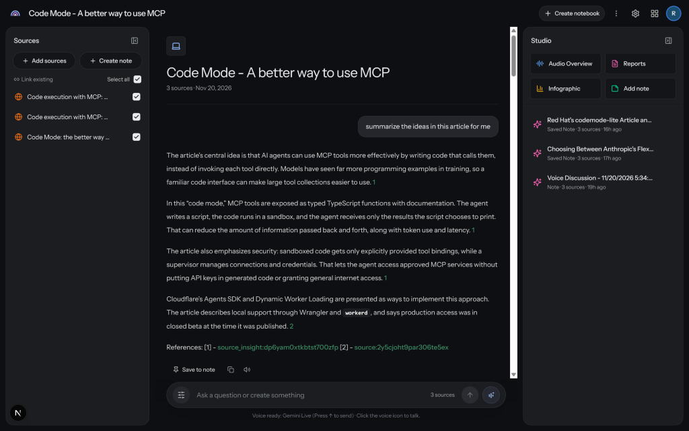
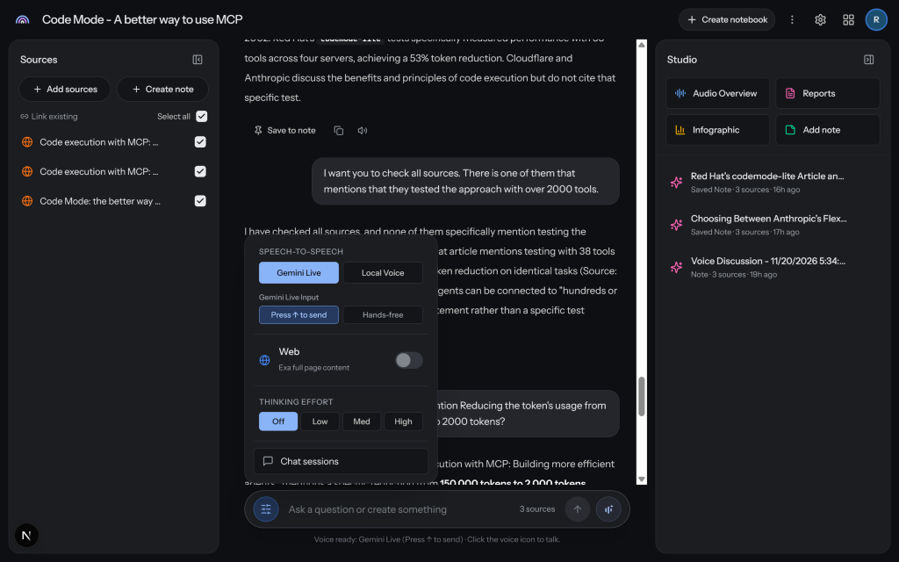
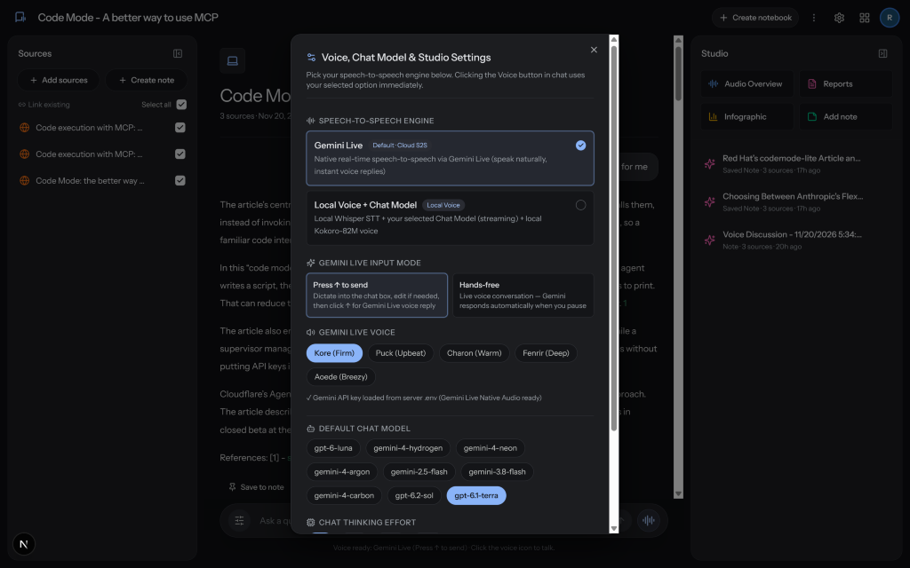

<a id="readme-top"></a>

[![MIT License][license-shield]][license-url]


<!-- PROJECT LOGO -->
<br />
<div align="center">
  

  <h2 align="center">Open Notebook — Voice Edition</h2>

  <p align="center">
    An open-source, multi-model AI research workspace with <strong>real-time Speech-to-Speech voice chat directly with your documents</strong> — powered by <strong>Gemini Live</strong> &amp; local neural voice.
    <br />
    <sub>Fork of <a href="https://github.com/lfnovo/open-notebook">lfnovo/open-notebook</a> (MIT License)</sub>
    <br />
    <br />
    <a href="docs/0-START-HERE/index.md">📚 Get Started</a>
    ·
    <a href="docs/3-USER-GUIDE/index.md">📖 User Guide</a>
    ·
    <a href="docs/2-CORE-CONCEPTS/index.md">✨ Features</a>
    ·
    <a href="docs/1-INSTALLATION/index.md">🚀 Deploy</a>
  </p>
</div>

<div align="center">
  <!-- Keep these links. Translations come from zdoc.app, which follows the current README automatically. Arabic and Turkish are hand-maintained under docs/i18n/ only because zdoc.app does not serve them; new languages are not added by hand (#1550). -->
  <a href="docs/i18n/ar/README.md" dir="rtl">العربية</a> |
  <a href="https://zdoc.app/de/lfnovo/open-notebook">Deutsch</a> | 
  <a href="https://zdoc.app/es/lfnovo/open-notebook">Español</a> | 
  <a href="https://zdoc.app/fr/lfnovo/open-notebook">français</a> | 
  <a href="https://zdoc.app/ja/lfnovo/open-notebook">日本語</a> | 
  <a href="https://zdoc.app/ko/lfnovo/open-notebook">한국어</a> | 
  <a href="https://zdoc.app/pt/lfnovo/open-notebook">Português</a> | 
  <a href="https://zdoc.app/ru/lfnovo/open-notebook">Русский</a> | 
  <a href="docs/i18n/tr/README.md">Türkçe</a> |
  <a href="https://zdoc.app/zh/lfnovo/open-notebook">中文</a>
</div>

## 🎙️ Voice Chat with Your Documents



This fork extends [Open Notebook](https://github.com/lfnovo/open-notebook) with **built-in, real-time Speech-to-Speech voice chat grounded directly in your documents**, paired with a streamlined dark 3-column workspace:

- **🗣️ Talk Directly to Your Documents:** Click the voice icon inside the chat input bar to ask spoken questions grounded in your selected sources and notes, with **real-time word-by-word highlighting synced to speech**, and every voice turn saved automatically to your chat history.
- **🎛️ Simple 2-Option Speech-to-Speech Switcher** (accessible from the chat **Sliders** menu or **⚙ Settings**):
  1. **Gemini Live (Default):** Native speech-to-speech powered by Gemini Live (`gemini-2.5-flash-native-audio-latest`) via a server-side WebSocket proxy (keeps your API key in `.env`). Includes a 1-click toggle between **Press ↑ to send** *(default — dictate, review/edit, then send)* and **Hands-free** conversation.
  2. **Local Voice + Chat Model:** Local `faster-whisper` speech-to-text + your chosen streaming chat model + local **Kokoro-82M** neural text-to-speech, plus a **Read Aloud** speaker button on every reply and overview.
- **🖥️ Dark 3-Column Research Workspace (`Sources` | `Chat` | `Studio`):** Drag-to-resize Sources panel with full-title/URL hover tooltips, automatic notebook overviews, paired Q&A **Save to note**, **Studio Infographics**, and quick **Thinking Effort** controls.
- **📂 Dedicated GitHub Import:** Introduced a specialized section for GitHub repository ingestion including sub-directory and file type filtering capabilities.
- **✏️ Editable Prompts for Generating Customized Reports:** Added a custom "Prompt" button allowing prompt tailoring to generate specialized reports and podcasts.
- **🎧 Custom Audio Player:** Replaced native playback with an inline Studio bar featuring **5-second rewind and forward skip buttons**.
- **🌐 Toggleable Web Search:** Enable web search right from the chat input so the model can answer using only your notebook sources or expand its search to the web when needed.

| Quick Chat Voice Switcher | Voice, Chat Model & Studio Settings |
| :---: | :---: |
|  |  |

---

## Core Capabilities

**Open Notebook empowers you to:**
- 🔒 **Control your data** - Self-hosted research workspace where your data stays yours
- 🤖 **Choose your AI models** - 20+ providers including Google Gemini, OpenAI, Anthropic, Mistral, Ollama, and any OpenAI-compatible server (LM Studio, vLLM)
- 📚 **Organize multi-modal content** - PDFs, videos, audio, web pages, and more
- 🎙️ **Talk to your sources & generate podcasts** - Real-time Speech-to-Speech voice chat plus multi-speaker podcast generation
- 🔍 **Search intelligently** - Full-text and vector search across all your content
- 💬 **Chat with context** - Grounded AI conversations with clickable source citations
- 🌐 **Multi-language UI** - English, Bengali, Catalan, Chinese (Simplified & Traditional), French, German, Italian, Japanese, Polish, Portuguese, Russian, Spanish and Turkish

### Built With

[![Python][Python]][Python-url] [![Next.js][Next.js]][Next-url] [![React][React]][React-url] [![SurrealDB][SurrealDB]][SurrealDB-url] [![LangChain][LangChain]][LangChain-url]

## 🚀 Quick Start

### Prerequisites
- [Docker Desktop](https://www.docker.com/products/docker-desktop/) (macOS, Windows) or Docker Engine with the Compose plugin (Linux)
- An API key from an AI provider, or a local model server such as Ollama. You add it in the UI, not in config files.

### Step 1: Download docker-compose.yml
```bash
mkdir open-notebook && cd open-notebook
curl -o docker-compose.yml https://raw.githubusercontent.com/lfnovo/open-notebook/main/docker-compose.yml
```

This is the official [docker-compose.yml](docker-compose.yml) from this repository. It runs two services: `surrealdb` (the database) and `open_notebook` (UI, API and background worker).

### Step 2: Set your encryption key
Create a `.env` file next to `docker-compose.yml` and set `OPEN_NOTEBOOK_ENCRYPTION_KEY` to a long random secret you generate yourself (for example with `openssl rand -hex 32`; [other options](docs/1-INSTALLATION/docker-compose.md#step-2-set-your-encryption-key)). The shipped compose file reads it from `.env`. Editing that line in `docker-compose.yml` is a valid alternative. It encrypts the API keys you store; keep it. When neither is set, the file falls back to `change-me-to-a-secret-string` only for installs that used that placeholder. If an existing install has a custom key in its old compose file, copy that exact key into `.env` before replacing the file; do not generate a new one. That fallback is public. Replace it before you save provider keys.

> **Shared network or server?** The UI (`8502`) and API (`5055`) are published on all network interfaces and there is no password by default. If other devices can reach this machine, change those two port lines to `"127.0.0.1:8502:8502"` and `"127.0.0.1:5055:5055"`, or set `OPEN_NOTEBOOK_PASSWORD` in the same `.env` file, before starting.

### Step 3: Start services
```bash
docker compose up -d
```

Wait about 30 seconds, then open: **http://localhost:8502**

### Step 4: Connect an AI provider
1. In the sidebar, open **Models** (under Manage).
2. Find your provider (OpenAI, Anthropic, Google, etc.) and click **Add Configuration**.
3. Enter a name and your API key (local providers such as Ollama need a **Base URL** instead), then click **Add Configuration**.
4. Click **Test** on the new configuration to check the connection.
5. Click **Models**, choose a **Model Type**, tick the models to add and click **Add**. Add at least one **Language** model and one **Embedding** model.
6. Under **Default Model Assignments**, click **Auto-assign Defaults** (or pick the models yourself).

Done! Create a notebook, add a source and start chatting. Full walkthrough: [Connect a provider](docs/4-AI-PROVIDERS/index.md#connect-a-provider).

> **Need an API key?** Get one from:
> [OpenAI](https://platform.openai.com/api-keys) · [Anthropic](https://console.anthropic.com/settings/keys) · [Google](https://aistudio.google.com/app/apikey) · [Groq](https://console.groq.com/keys)
>
> Anthropic and Groq have no embedding models; pair them with a provider that does (see the [matrix](#provider-support-matrix)).

> **Want free local AI?** See the [Local Quick Start](docs/0-START-HERE/quick-start-local.md) (Ollama in Docker).

---

### 📚 More Installation Options

- **[Local AI with Ollama](docs/0-START-HERE/quick-start-local.md)** - Run models locally without API costs
- **[Docker Compose guide](docs/1-INSTALLATION/docker-compose.md)** - Settings, backups, updates, remote access
- **[From Source (Developers)](docs/1-INSTALLATION/from-source.md)** - For development and contributions
- **[Complete Installation Guide](docs/1-INSTALLATION/index.md)** - All deployment scenarios

---

### 📖 Need Help?

- **🤖 AI Installation Assistant**: [CustomGPT to help you install](https://chatgpt.com/g/g-68776e2765b48191bd1bae3f30212631-open-notebook-installation-assistant)
- **🆘 Troubleshooting**: [5-minute troubleshooting guide](docs/6-TROUBLESHOOTING/quick-fixes.md)
- **💬 Community Support**: [Discord Server](https://discord.gg/37XJPXfz2w)
- **🐛 Report Issues**: [GitHub Issues](https://github.com/lfnovo/open-notebook/issues)

---

## Provider Support Matrix

Thanks to the [Esperanto](https://github.com/lfnovo/esperanto) library, we support these providers out of the box. The columns show the model types each provider offers; what you can use depends on your account.

| Provider     | LLM Support | Embedding Support | Speech-to-Text | Text-to-Speech |
|--------------|-------------|------------------|----------------|----------------|
| OpenAI       | ✅          | ✅               | ✅             | ✅             |
| Anthropic    | ✅          | ❌               | ❌             | ❌             |
| Google (GenAI) | ✅          | ✅               | ✅             | ✅             |
| Groq         | ✅          | ❌               | ✅             | ❌             |
| Mistral      | ✅          | ✅               | ✅             | ✅             |
| DeepSeek     | ✅          | ❌               | ❌             | ❌             |
| xAI          | ✅          | ❌               | ❌             | ✅             |
| OpenRouter   | ✅          | ✅               | ✅             | ✅             |
| DashScope (Qwen) | ✅          | ❌               | ❌             | ❌             |
| MiniMax      | ✅          | ❌               | ❌             | ✅             |
| Novita       | ✅          | ❌               | ❌             | ❌             |
| SiliconFlow  | ✅          | ❌               | ❌             | ❌             |
| Z.ai         | ✅          | ❌               | ❌             | ❌             |
| PayPerQ (PPQ) | ✅          | ✅               | ✅             | ✅             |
| Cohere       | ✅          | ✅               | ❌             | ❌             |
| Voyage       | ❌          | ✅               | ❌             | ❌             |
| ElevenLabs   | ❌          | ❌               | ✅             | ✅             |
| Deepgram     | ❌          | ❌               | ✅             | ✅             |
| Ollama       | ✅          | ✅               | ❌             | ❌             |
| oMLX         | ✅          | ✅               | ❌             | ❌             |
| Azure OpenAI | ✅          | ✅               | ✅             | ✅             |
| Vertex AI    | ✅          | ✅               | ❌             | ✅             |
| OpenAI Compatible* | ✅          | ✅               | ✅             | ✅             |
| Anthropic Compatible | ✅          | ❌               | ❌             | ❌             |

*Supports LM Studio and any OpenAI-compatible endpoint. Prefer the native **oMLX** provider for [oMLX](https://omlx.ai/) (Apple Silicon); see [docs/5-CONFIGURATION/omlx.md](docs/5-CONFIGURATION/omlx.md).

## ✨ Key Features

### Core Capabilities
- **🔒 Privacy-First**: Self-hosted; with local models nothing leaves your machine
- **🎯 Multi-Notebook Organization**: Manage multiple research projects seamlessly
- **📚 Universal Content Support**: PDFs, videos, audio, web pages, Office docs, and more
- **🤖 Multi-Model AI Support**: 20+ providers including OpenAI, Anthropic, Ollama, Google, LM Studio, and more
- **🎙️ Professional Podcast Generation**: Advanced multi-speaker podcasts with Episode Profiles
- **🔍 Intelligent Search**: Full-text and vector search across all your content
- **💬 Context-Aware Chat**: AI conversations powered by your research materials
- **📝 AI-Assisted Notes**: Generate insights or write notes manually

### Advanced Features
- **⚡ Reasoning Model Support**: Full support for thinking models like DeepSeek-R1 and Qwen3
- **🔧 Content Transformations**: Powerful customizable actions to summarize and extract insights
- **🌐 Comprehensive REST API**: Full programmatic access for custom integrations [](http://localhost:5055/docs)
- **🔐 Optional Password Protection**: Secure public deployments with authentication
- **📊 Fine-Grained Context Control**: Choose exactly what to share with AI models
- **📎 Citations**: Get answers with proper source citations


## Podcast Feature

[](https://www.youtube.com/watch?v=D-760MlGwaI)

## 📚 Documentation

### Getting Started
- **[📖 Introduction](docs/0-START-HERE/index.md)** - Learn what Open Notebook offers
- **[⚡ Quick Start with a Cloud Provider](docs/0-START-HERE/quick-start-cloud.md)** - OpenAI, Anthropic, Google and more in 5 minutes
- **[🔧 Installation](docs/1-INSTALLATION/index.md)** - Comprehensive setup guide
- **[🎯 Run It Fully Local](docs/0-START-HERE/quick-start-local.md)** - Ollama/LM Studio, completely private

### User Guide
- **[📱 Interface Overview](docs/3-USER-GUIDE/interface-overview.md)** - Understanding the layout
- **[📚 Notebooks, Sources & Notes](docs/2-CORE-CONCEPTS/notebooks-sources-notes.md)** - Organizing your research
- **[📄 Adding Sources](docs/3-USER-GUIDE/adding-sources.md)** - Managing content types
- **[📝 Working with Notes](docs/3-USER-GUIDE/working-with-notes.md)** - Creating and managing notes
- **[💬 Chatting Effectively](docs/3-USER-GUIDE/chat-effectively.md)** - AI conversations
- **[🔍 Search](docs/3-USER-GUIDE/search.md)** - Finding information

### Advanced Topics
- **[🎙️ Podcast Generation](docs/2-CORE-CONCEPTS/podcasts-explained.md)** - Create professional podcasts
- **[🔧 Content Transformations](docs/3-USER-GUIDE/transformations.md)** - Customize content processing
- **[🤖 AI Providers](docs/4-AI-PROVIDERS/index.md)** - Connect providers and set default models
- **[🔌 MCP Integration](docs/5-CONFIGURATION/mcp-integration.md)** - Connect with Claude Desktop, VS Code and other MCP clients
- **[🔧 REST API Reference](docs/7-DEVELOPMENT/api-reference.md)** - Complete API documentation
- **[🔐 Security](docs/5-CONFIGURATION/security.md)** - Password protection and privacy
- **[🚀 Deployment](docs/1-INSTALLATION/index.md)** - Complete deployment guides for all scenarios
- **[🧭 Vision & Principles](VISION.md)** - What Open Notebook is, and where it's going
- **[🛠️ Developer Docs](docs/7-DEVELOPMENT/index.md)** - Architecture, setup, contributing, decision records

<p align="right">(<a href="#readme-top">back to top</a>)</p>

## 🗺️ Where We're Going

Right now the focus is on making the core experience (sources, chat, search, notes, podcasts) solid across every provider and deployment, before adding new product surfaces. The bigger directions under consideration, such as multi-user support, new output formats and agents operating Open Notebook through MCP, are described in the **Horizon** section of [VISION.md](VISION.md#horizon). They are directions, not dated promises.

Explore [GitHub Discussions](https://github.com/lfnovo/open-notebook/discussions/categories/ideas) for proposed features and product ideas, and [open Issues](https://github.com/lfnovo/open-notebook/issues) for known bugs and approved work. Recent changes are in the [CHANGELOG](CHANGELOG.md).

<p align="right">(<a href="#readme-top">back to top</a>)</p>


## 📖 Need Help?
- **🤖 AI Installation Assistant**: We have a [CustomGPT built to help you install Open Notebook](https://chatgpt.com/g/g-68776e2765b48191bd1bae3f30212631-open-notebook-installation-assistant) - it will guide you through each step!
- **New to Open Notebook?** Start with our [Getting Started Guide](docs/0-START-HERE/index.md)
- **Need installation help?** Check our [Installation Guide](docs/1-INSTALLATION/index.md)
- **Want to see it in action?** Try our [Quick Start Tutorial](docs/0-START-HERE/index.md)

## 🤝 Community & Contributing

### Join the Community
- 💬 **[Discord Server](https://discord.gg/37XJPXfz2w)** - Get help, share ideas, and connect with other users
- 𝕏 **[Follow @lfnovo on X](https://x.com/lfnovo)** - Project updates and news from the maintainer
- 💡 **[GitHub Discussions](https://github.com/lfnovo/open-notebook/discussions)** - Ask questions and shape features, product direction, design, and architecture
- 🐛 **[GitHub Issues](https://github.com/lfnovo/open-notebook/issues)** - Report reproducible bugs and find approved work
- ⭐ **Star this repo** - Show your support and help others discover Open Notebook

### Contributing
We welcome contributions! We're especially looking for help with:
- **Frontend Development**: Help improve our modern Next.js/React UI
- **Testing & Bug Fixes**: Make Open Notebook more robust
- **Feature Development**: Build the coolest research tool together
- **Documentation**: Improve guides and tutorials

**Current Tech Stack**: Python, FastAPI, Next.js, React, SurrealDB

See our [Contributing Guide](CONTRIBUTING.md) for detailed information on how to get started, including our guidelines for [AI-assisted contributions](docs/7-DEVELOPMENT/contributing.md#ai-assisted-and-agent-generated-prs). To understand what we're building (and what we'll say no to), read [VISION.md](VISION.md).

<p align="right">(<a href="#readme-top">back to top</a>)</p>


## 📄 License

Open Notebook is MIT licensed. See the [LICENSE](LICENSE) file for details.


**Community Support**:
- 💬 [Discord Server](https://discord.gg/37XJPXfz2w) - Get help, share ideas, and connect with users
- 𝕏 [Follow @lfnovo on X](https://x.com/lfnovo) - Project updates and news from the maintainer
- 💡 [GitHub Discussions](https://github.com/lfnovo/open-notebook/discussions) - Ask questions and shape ideas
- 🐛 [GitHub Issues](https://github.com/lfnovo/open-notebook/issues) - Report reproducible bugs and find approved work
- 🌐 [Website](https://www.open-notebook.ai) - Learn more about the project

<p align="right">(<a href="#readme-top">back to top</a>)</p>


<!-- MARKDOWN LINKS & IMAGES -->
<!-- https://www.markdownguide.org/basic-syntax/#reference-style-links -->
[contributors-shield]: https://img.shields.io/github/contributors/lfnovo/open-notebook.svg?style=for-the-badge
[contributors-url]: https://github.com/lfnovo/open-notebook/graphs/contributors
[forks-shield]: https://img.shields.io/github/forks/lfnovo/open-notebook.svg?style=for-the-badge
[forks-url]: https://github.com/lfnovo/open-notebook/network/members
[stars-shield]: https://img.shields.io/github/stars/lfnovo/open-notebook.svg?style=for-the-badge
[stars-url]: https://github.com/lfnovo/open-notebook/stargazers
[issues-shield]: https://img.shields.io/github/issues/lfnovo/open-notebook.svg?style=for-the-badge
[issues-url]: https://github.com/lfnovo/open-notebook/issues
[license-shield]: https://img.shields.io/github/license/rpcoelho17/open-notebook.svg?style=for-the-badge
[license-url]: https://github.com/rpcoelho17/open-notebook/blob/notebooklm-voice-ui/LICENSE
[linkedin-shield]: https://img.shields.io/badge/-LinkedIn-black.svg?style=for-the-badge&logo=linkedin&colorB=555
[linkedin-url]: https://linkedin.com/in/lfnovo
[Next.js]: https://img.shields.io/badge/Next.js-000000?style=for-the-badge&logo=next.js&logoColor=white
[Next-url]: https://nextjs.org/
[React]: https://img.shields.io/badge/React-61DAFB?style=for-the-badge&logo=react&logoColor=black
[React-url]: https://reactjs.org/
[Python]: https://img.shields.io/badge/Python-3776AB?style=for-the-badge&logo=python&logoColor=white
[Python-url]: https://www.python.org/
[LangChain]: https://img.shields.io/badge/LangChain-3A3A3A?style=for-the-badge&logo=chainlink&logoColor=white
[LangChain-url]: https://www.langchain.com/
[SurrealDB]: https://img.shields.io/badge/SurrealDB-FF5E00?style=for-the-badge&logo=databricks&logoColor=white
[SurrealDB-url]: https://surrealdb.com/
